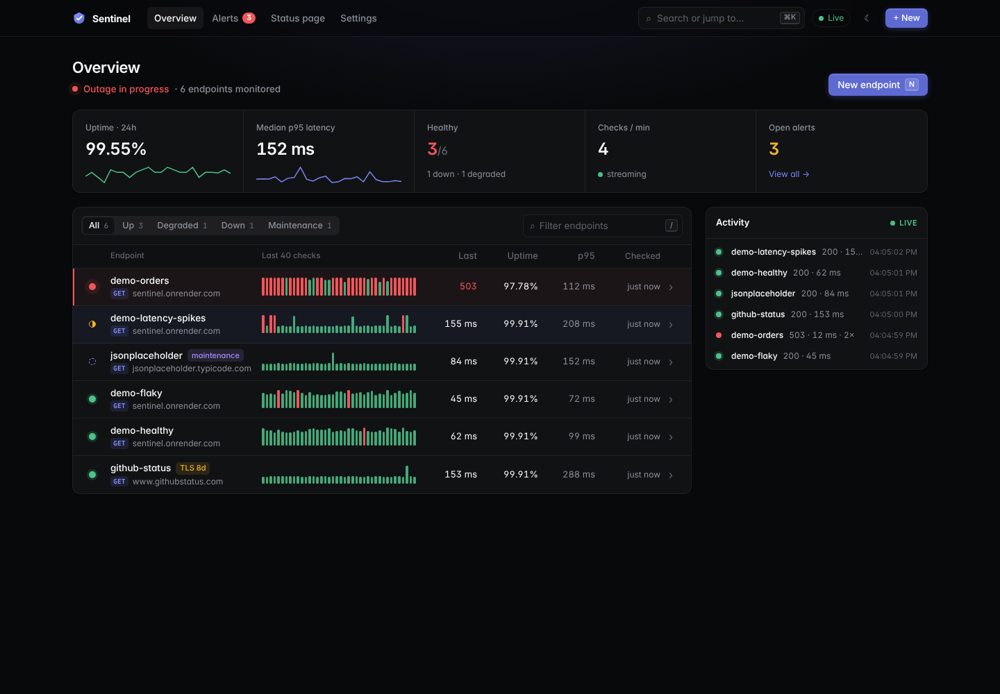
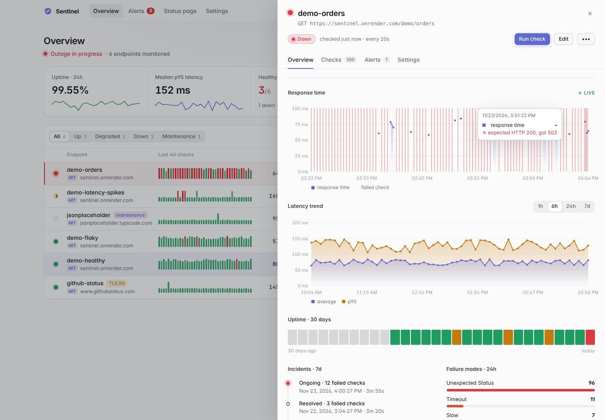
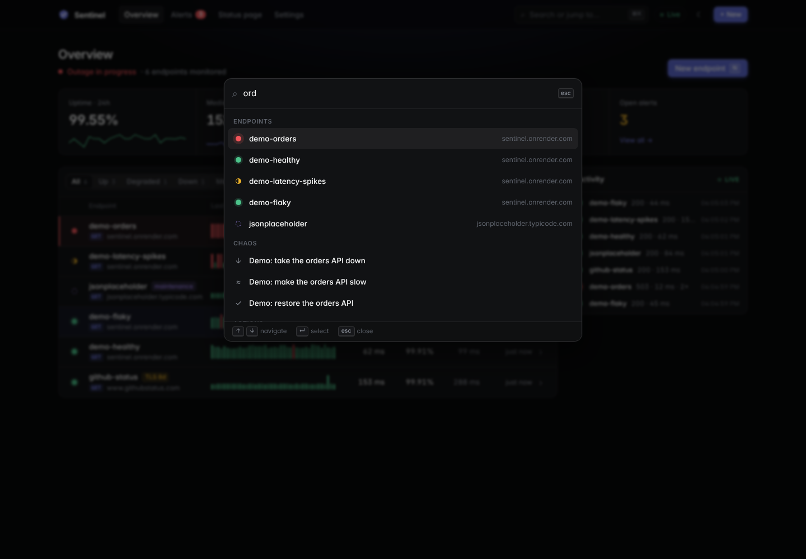
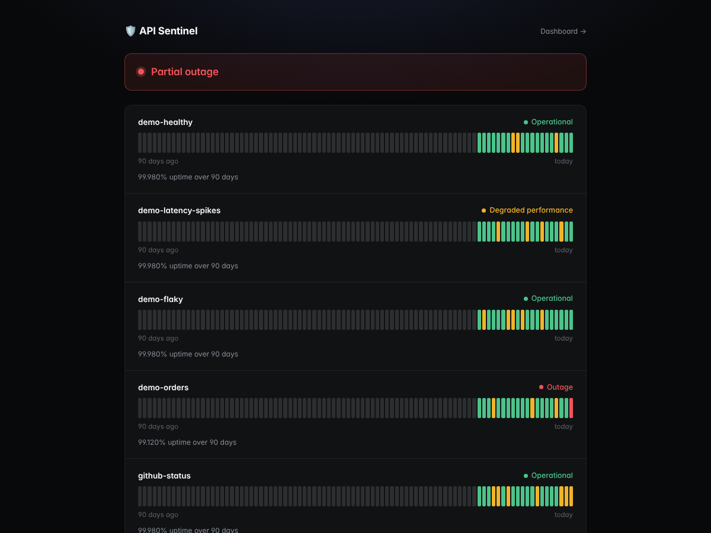
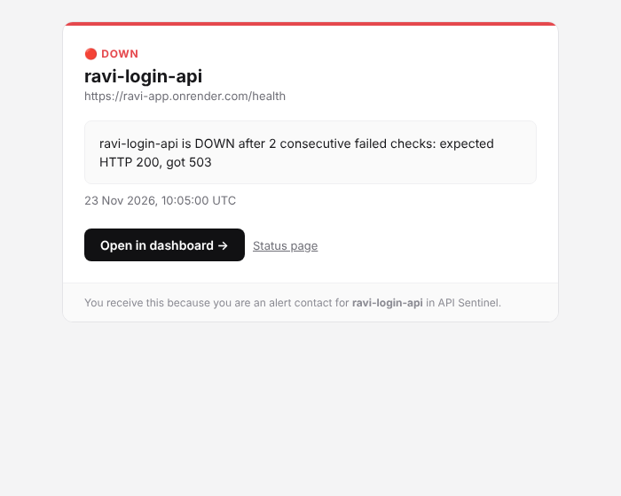
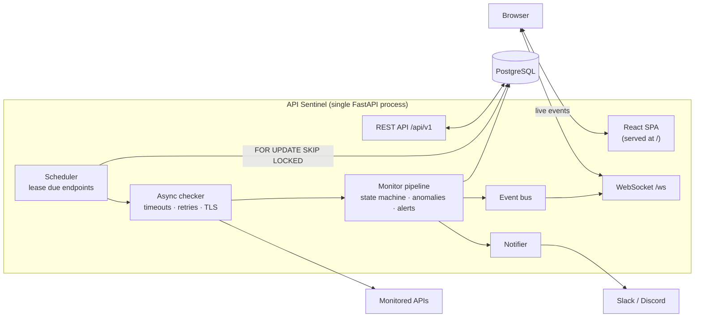

# 🛡️ API Sentinel

**Real-time API monitoring & reliability platform.** Sentinel health-checks your HTTP APIs around the
clock, streams every result to a live React dashboard over WebSockets, tracks uptime and p50/p95/p99
latency, detects latency anomalies with a robust statistical model, watches TLS certificates, and
alerts Slack/Discord when something breaks or recovers. It also publishes a public status page.


**Live demo:** `https://<your-app>.onrender.com` · **Status page:** `https://<your-app>.onrender.com/status`



---

## Features

| Area | What it does |
|---|---|
| **Real-time UI** | React dashboard fed by a WebSocket event stream: every check, status change and alert appears instantly, with toast notifications and a live activity feed. Auto-reconnects with backoff and resyncs over REST. |
| **Async check engine** | `httpx.AsyncClient` with connection pooling; hundreds of endpoints checked concurrently with bounded concurrency (backpressure) |
| **Reliability policies** | Per-endpoint timeouts, retries with **exponential backoff + jitter**, and retries only for transient failures (timeouts, connection errors, 429/5xx) |
| **Assertions & SLOs** | Expected status code, response-body assertion, latency SLO (`max_latency_ms`) → `degraded` state |
| **Health state machine** | `unknown → up / degraded → down → up`, with an N-consecutive-failures threshold to prevent flapping alerts |
| **Anomaly detection** | Robust z-score (median + MAD) over the last 50 successful checks flags slowdowns *before* they become outages |
| **TLS monitoring** | Probes each HTTPS endpoint's certificate every 6 h and warns 14 days before expiry |
| **Maintenance windows** | Mute alerts for planned downtime; maintenance checks are excluded from the SLA |
| **Public status page** | `/status` with 90-day uptime bars (`generate_series` SQL), live overall status and an incident history |
| **Alerting** | State-based DOWN/RECOVERED alerts (correct across restarts and maintenance), anomaly and TLS alerts with cooldowns |
| **Email notifications** | Each endpoint has its own alert contacts: API owners get HTML emails via **Brevo's HTTPS API** (works where SMTP is blocked) or SMTP, plus a one-click test email. Slack/Discord webhooks too |
| **Pro UX** | Linear-style UI: ⌘K command palette, keyboard shortcuts, slide-over detail panels, light/dark theme, animated live counters |
| **SQL analytics** | `percentile_cont` p50/p95/p99, `FILTER` aggregates, `date_trunc` buckets, `ROW_NUMBER()` sparklines, **gaps-and-islands incident detection** |
| **Horizontal scaling** | Endpoints are leased with `SELECT … FOR UPDATE SKIP LOCKED`, so multiple replicas share one DB without double-checking |
| **Security** | Admin API key (constant-time compare) for all writes, **SSRF protection** (blocks private/loopback/metadata IPs), non-root container |
| **Observability** | Prometheus `/metrics` + Grafana, structured JSON logs with request IDs, liveness/readiness probes |
| **Ops** | Alembic migrations, retention job, multi-stage Docker build (Node → Python), GitHub Actions CI, one-click Render Blueprint |
| **Chaos demo** | Built-in flaky API at `/demo` that you can take down or slow down from the UI to watch detection happen live |

<table>
<tr>
<td></td>
<td></td>
</tr>
<tr>
<td></td>
<td></td>
</tr>
</table>

## Architecture



**One check, end to end:**
1. The scheduler leases due endpoints by moving `next_check_at` forward in the same transaction.
2. The HTTP check and TLS probe run **with no DB connection held**.
3. The result is scored against the latency baseline.
4. The state machine updates the endpoint's status.
5. Alerts are reconciled and committed.
6. Webhooks are delivered *after* the commit.
7. The result is published on the event bus, so every connected browser sees it within milliseconds.

## Quick start (local)

```bash
git clone https://github.com/<your-username>/api-sentinel.git && cd api-sentinel
docker compose up -d --build        # Postgres, API + dashboard, Prometheus, Grafana
```

Open <http://localhost:8000>. Demo endpoints are created automatically. Go to **Settings → Chaos
controls → Take it down** and watch `demo-orders` fail, alert and recover in real time.

| URL | |
|---|---|
| http://localhost:8000 | Live dashboard |
| http://localhost:8000/status | Public status page |
| http://localhost:8000/docs | Interactive OpenAPI docs |
| http://localhost:8000/metrics | Prometheus metrics |
| http://localhost:3000 | Grafana (Prometheus datasource pre-configured) |

**Frontend development** (hot reload): `cd frontend && npm install && npm run dev` serves the UI on
:5173 and proxies to the backend on :8000.

## Deploy for free

Render (free web service) + Supabase (free Postgres): see **[DEPLOY.md](DEPLOY.md)**. It takes about
15 minutes and needs no credit card.

## API

| Method | Path | Description |
|---|---|---|
| `POST` | `/api/v1/endpoints` | Register an endpoint 🔒 |
| `GET` | `/api/v1/endpoints?status=down&is_active=true` | List (filter + paginate) |
| `GET` / `PATCH` / `DELETE` | `/api/v1/endpoints/{id}` | Read / update 🔒 / delete 🔒 |
| `POST` | `/api/v1/endpoints/{id}/check` | Run a check now 🔒 |
| `POST` / `DELETE` | `/api/v1/endpoints/{id}/maintenance` | Start / end a maintenance window 🔒 |
| `POST` | `/api/v1/endpoints/{id}/test-alert` | Send a test email to the endpoint's contacts 🔒 |
| `GET` | `/api/v1/endpoints/{id}/results` | Check history |
| `GET` | `/api/v1/analytics/summary` | Uptime + p50/p95/p99 per endpoint |
| `GET` | `/api/v1/analytics/recent` | Last N checks per endpoint (sparklines) |
| `GET` | `/api/v1/analytics/endpoints/{id}/timeseries` | Latency over time |
| `GET` | `/api/v1/analytics/endpoints/{id}/uptime-daily` | Daily uptime % |
| `GET` | `/api/v1/analytics/endpoints/{id}/incidents` | Outage periods |
| `GET` | `/api/v1/analytics/endpoints/{id}/errors` | Failure breakdown |
| `GET` | `/api/v1/alerts` · `POST /api/v1/alerts/{id}/resolve` 🔒 | Alerts |
| `GET` | `/api/v1/status` | Public status page data |
| `WS` | `/ws` | Live event stream (`check`, `status_changed`, `alert`, `endpoint`) |

🔒 = requires the `X-API-Key` header when `SENTINEL_API_KEY` is set.

## Design decisions

<details>
<summary><b>Why WebSockets and an in-process event bus?</b></summary>

The monitor publishes each result to a bus. Every WebSocket client gets its own bounded queue, and a
slow client loses its oldest events instead of blocking the monitor. After a reconnect, the UI resyncs
over REST, so a dropped event never leaves it inconsistent. Heartbeats every 25 s keep proxies from
closing idle connections. With several replicas, the bus would move to PostgreSQL `LISTEN/NOTIFY` or
Redis pub/sub.
</details>

<details>
<summary><b>Why state-based alerting?</b></summary>

Alerts are reconciled against state rather than fired on transitions:
- The endpoint is DOWN and there is no open DOWN alert → create one.
- The endpoint is no longer DOWN and there is an open DOWN alert → resolve it and send RECOVERED.

This stays correct when an outage starts during a maintenance window and continues after it, across
process restarts, and when a manual check races the scheduler.
</details>

<details>
<summary><b>Why a lease-based scheduler instead of APScheduler / Celery?</b></summary>

Schedule state lives in PostgreSQL (`next_check_at`), not in process memory. Each tick claims due rows
with `FOR UPDATE SKIP LOCKED` and moves `next_check_at` forward in the same transaction. Restarts lose
nothing, and running several replicas needs no leader election or message broker. A tick only claims as
many endpoints as it has free concurrency slots, which gives natural backpressure.
</details>

<details>
<summary><b>Why median/MAD instead of mean/std-dev for anomalies?</b></summary>

Latency is long-tailed. Past spikes inflate the standard deviation and hide new ones. The modified
z-score `0.6745·(x − median)/MAD` is robust to those outliers. The spread is floored at 5% of the median,
so a flat endpoint doesn't alert on 1 ms of jitter, and only slowdowns are flagged.
</details>

<details>
<summary><b>How are incidents and the 90-day status bars computed?</b></summary>

*Incidents* use gaps-and-islands: `ROW_NUMBER() OVER (ORDER BY t) − ROW_NUMBER() OVER (PARTITION BY
is_success ORDER BY t)` is constant within each run of consecutive failures.

*Status bars* `CROSS JOIN` a `generate_series` of days with the endpoints, so days without data still
appear. Maintenance checks are excluded from uptime.
</details>

<details>
<summary><b>Why SSRF protection?</b></summary>

A public monitoring service makes HTTP requests to user-supplied URLs. Without a guard, someone could
point it at `169.254.169.254` (cloud metadata), `localhost:5432` or `10.x` addresses to probe the host's
private network. Sentinel resolves the hostname and refuses non-global IPs when
`SENTINEL_BLOCK_PRIVATE_TARGETS=true`. The remaining gap is DNS rebinding, which pinning the resolved IP
in the HTTP transport would close.
</details>

## Testing

```bash
pip install -r requirements-dev.txt
pytest -m "not postgres"                     # fast suite on SQLite
TEST_DATABASE_URL=postgresql+asyncpg://... pytest --cov   # full suite incl. PostgreSQL analytics
```

The outbound network is replaced by a scripted `httpx.MockTransport`, so the tests can simulate
outages, timeouts, TLS expiry and recoveries deterministically. CI runs:
- lint
- an Alembic upgrade/downgrade round-trip
- both test suites, with an 80% coverage gate
- the frontend build
- a Docker build

## Project structure

```
app/
├── api/routes/        endpoints · analytics · alerts · system (status, meta) · live (WebSocket) · health
├── core/              settings · structured logging · clock
├── db/                SQLAlchemy base + async engine (hosted-Postgres URL handling)
├── models/            Endpoint · CheckResult · Alert
├── schemas/           Pydantic request/response models
├── services/
│   ├── checker.py     async HTTP checks, retries, backoff, assertions
│   ├── scheduler.py   lease-based loop with backpressure
│   ├── monitor.py     check → anomaly → state → alerts → events pipeline
│   ├── state.py       health state machine (pure)
│   ├── anomaly.py     robust z-score detector (pure)
│   ├── analytics.py   raw SQL analytics
│   ├── events.py      pub/sub bus for the WebSocket stream
│   ├── ssl_check.py   TLS certificate expiry probe
│   ├── url_guard.py   SSRF protection
│   ├── status_page.py public status page model
│   ├── notifier.py    log · webhook · email (Brevo HTTPS API / SMTP)
│   └── email_templates.py  HTML alert emails
└── observability/     Prometheus metrics
frontend/src/          React app: pages, live store (WebSocket), SVG charts
alembic/               migrations
demo/                  chaos-enabled demo API (mounted at /demo)
tests/                 unit + integration tests
```
